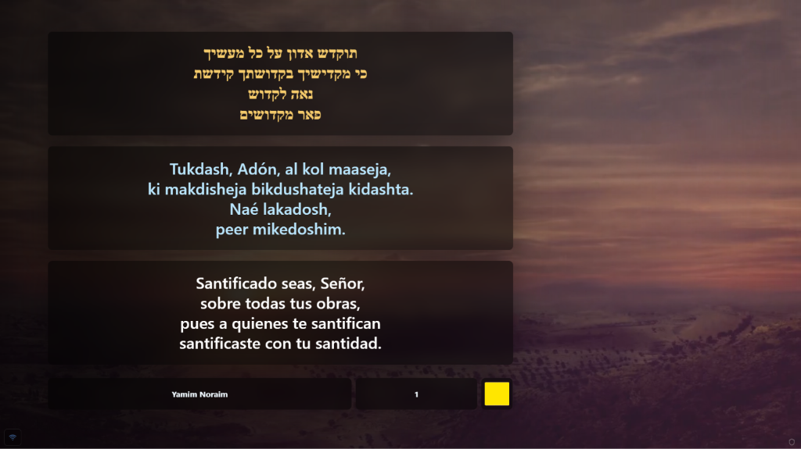
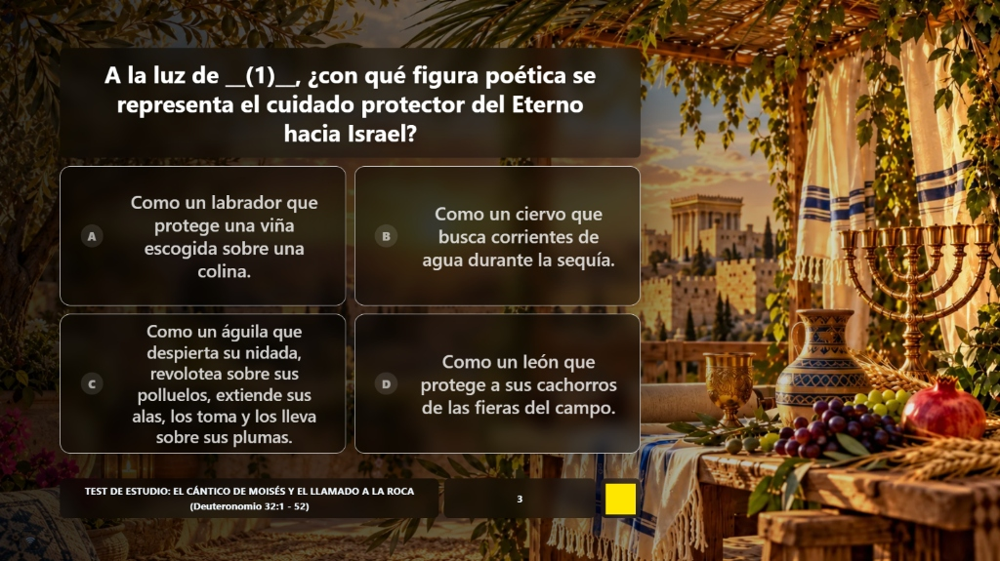
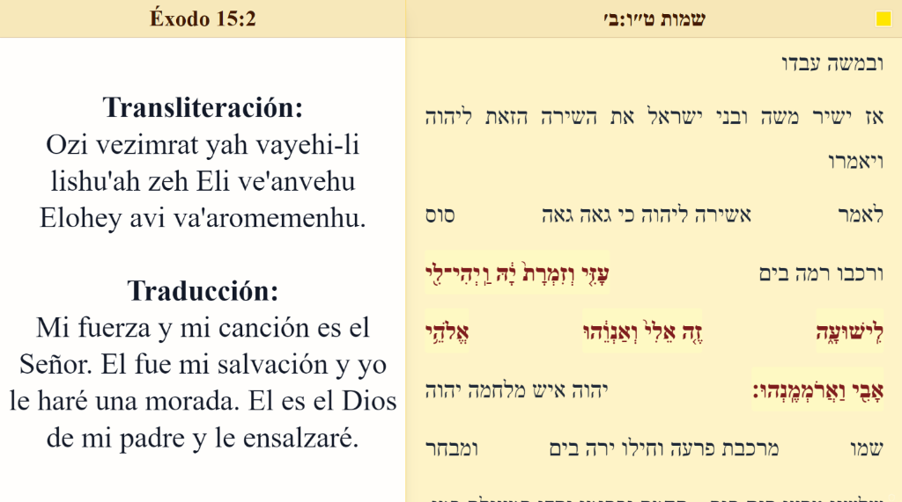
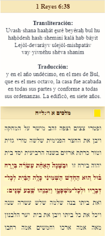
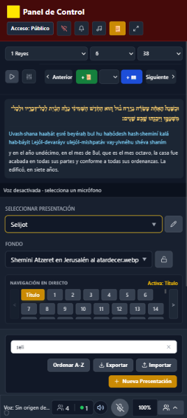
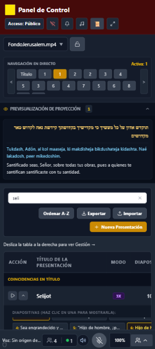

# SeferPresenter

SeferPresenter es una aplicación web autohospedada para dirigir presentaciones
multilingües, proyectar textos y medios, y compartir una sesión con una audiencia.
Un operador trabaja desde Control; Presenter muestra la proyección y Audience
permite seguirla desde otros dispositivos.

## Estado del proyecto

Versión preliminar `0.1.0-alpha`. El código se encuentra estructurado y validado
para pruebas locales y despliegues experimentales. El alcance detallado, los límites
y la lista de trabajo restante están registrados en [TODO](TODO.md), en las
[notas de release](RELEASE_NOTES_v0.1.0-alpha.md) y en la
[guía de preparación](docs/guides/prepare-release.md).

## Qué permite hacer

- Seleccionar y editar presentaciones; navegar entre diapositivas y controlar
  fondos, texto, música y vídeo.
- Sincronizar la proyección desde Control hacia Presenter y Audience mediante
  un backend común.
- Consultar y proyectar referencias de un corpus instalado por el operador.
- Realizar actividades de quiz con respuestas locales y resultados agregados.
- Habilitar Live Audio para escuchar, pedir palabra y moderar micrófonos.
- Habilitar Voice Scripture para interpretar referencias habladas mediante STT
  local. Su reconocimiento depende del corpus, motor, hardware y entorno.

Live Audio y Voice Scripture son opcionales y requieren configuración propia.
La interfaz puede seleccionarse en español, inglés, francés y hebreo; el idioma
es independiente del contenido proyectado. Las traducciones nuevas son borradores
pendientes de revisión lingüística. Consulte [i18n](docs/development/i18n.md).

La reproducción y captura también dependen de permisos, interacción del usuario
y restricciones del navegador; el estado sincronizado no garantiza recepción
física de audio.

## Pantallas de una sesión

| Ruta | Uso |
| --- | --- |
| `/control` | Operación, edición, navegación y administración |
| `/presenter` | Pantalla de proyección |
| `/audience` | Recepción e interacción permitida para participantes |
| `/audio-editor` | Edición de mapas de sincronización de audio |
| `/proteccion-datos` | Información de privacidad de la instalación |

Para probar el recorrido completo, use [primera sesión](docs/guides/first-session.md).

## Capturas de pantalla

### Proyección en directo (`/presenter`)

| Diapositivas sincronizadas | Cuestionarios interactivos (Quiz en vivo) |
| :---: | :---: |
|  |  |

### Modo Sefer y fidelidad masorética

Maquetación poética especial para *Shirat HaYam* (Éxodo 15, Cántico del Mar) con disposición tradicional *"Ariaj al gabey leveina"* (ladrillo sobre medio ladrillo) y versículo activo resaltado:



Navegación textual y exégesis en doble columna (escritorio) y adaptable a dispositivos móviles para la audiencia (`/audience`):

| Vista escritorio (doble columna) | Vista reducida / móvil |
| :---: | :---: |
|  |  |

### Consola de Operador (`/control`)

Administración completa de la sesión: selección de textos, control de fondos y medios, previsualización en vivo y navegación por diapositivas:

| Navegación de textos y diapositivas | Previsualización y catálogo |
| :---: | :---: |
|  |  |


## Probarlo en desarrollo local

Necesita Git, npm y Node.js 24 LTS (`24.x`). Docker no es necesario para el
frontend/backend base.

```sh
git clone https://github.com/CesarJER/SeferPresenter.git
cd SeferPresenter
npm ci
npm run dev
```

En PowerShell puede usar `npm.cmd`. Abra la URL indicada por Vite y añada
`/control`. Prepare una presentación de prueba si el catálogo está vacío.

`dev` inicia Vite y el backend local. Por defecto desactiva autenticación si
no se configuró; este inicio rápido es para desarrollo, no para exponer una
instalación a Internet. Revise cualquier `.env` existente antes de arrancar.

El arranque inicializa datos ausentes desde ejemplos neutrales. No incluye
corpus ni medios del operador y `dev` no genera el corpus. Para instalar,
configurar HTTPS/autenticación, habilitar voz o ejecutar un artefacto construido,
siga [operación](docs/operations/deployment.md). Los hooks de build pueden escribir
corpus; `deploy` además optimiza medios y utiliza configuración privada de instancia.

## Datos y privacidad de una instalación

Presentaciones, mapas, corpus, medios, branding y configuración de instancia
residen en `SEFER_DATA_DIR`, separados del producto. Hay
[ejemplos neutrales](examples/SeferPrivateData/README.md) para preparar una instalación.

El árbol `public/` de esa raíz puede servirse a visitantes: estar fuera de Git
no significa ser confidencial. La política aplicable, retención y permisos
dependen también del operador y su despliegue. Revise
[privacidad](docs/privacy/README.md) antes de incorporar participantes o datos reales.

## Documentación y colaboración

[docs/README.md](docs/README.md) es la entrada común para usuarios, operadores,
desarrolladores y agentes de IA.

- [Arquitectura](docs/architecture/overview.md) y
  [sincronización](docs/architecture/synchronization.md): responsabilidades y autoridad.
- [HTTP y realtime](docs/api/README.md): interfaces, permisos, errores y límites.
- [Desarrollo](docs/development/guide.md) y [AGENTS.md](AGENTS.md): cómo descubrir,
  modificar y validar el proyecto preservando cambios existentes.
- [Live Audio](docs/features/live-audio.md) y
  [Voice Scripture](docs/features/voice-scripture.md): comportamiento y limitaciones.
- [ADR](docs/adr/README.md): decisiones y evidencia histórica.

Para comunicar un problema, incluya commit/versión, configuración pertinente,
pasos, resultado esperado y observado. Use ejemplos sintéticos y retire
credenciales, transcripciones y datos de participantes. Los resultados de una
prueba local deben distinguirse de una verificación en dispositivos y redes reales.

## Licencia y términos

SeferPresenter está licenciado bajo la **GNU General Public License v3.0** ([LICENSE](LICENSE)).  
Copyright (C) 2026 [CesarJER](https://github.com/CesarJER).

- **Contribuciones:** Las aportaciones al repositorio se gestionan bajo el acuerdo de colaboradores del proyecto ([CLA.md](CLA.md)). Consulte [CONTRIBUTING.md](CONTRIBUTING.md) para más detalles.
- **Licenciamiento puntual non-GPLv3:** Para solicitudes de integración o licenciamiento bajo términos alternativos no-GPLv3 (por ejemplo, para su inclusión en proyectos con restricciones incompatibles con copyleft como RTL u otros), contacte directamente con el autor en [https://github.com/CesarJER](https://github.com/CesarJER).

## Contributors:
This project is tested with BrowserStack
- **Activos y librerías de terceros:** Los efectos de audio, librerías de producción y herramientas de desarrollo de terceros cuentan con sus correspondientes atribuciones y avisos legales en [THIRD_PARTY_NOTICES.md](THIRD_PARTY_NOTICES.md).
