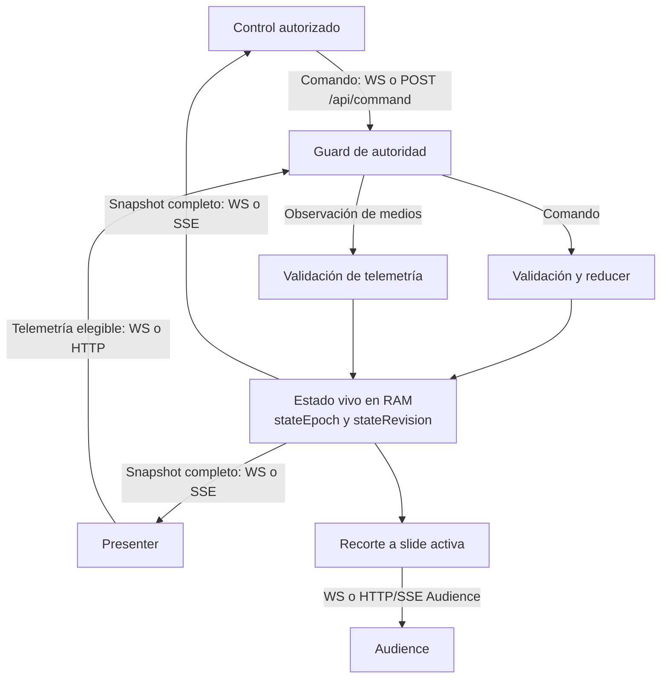
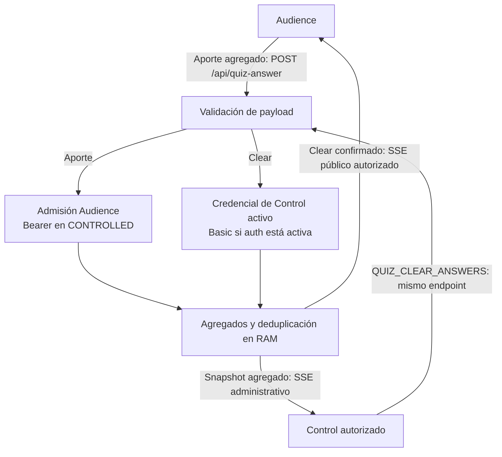
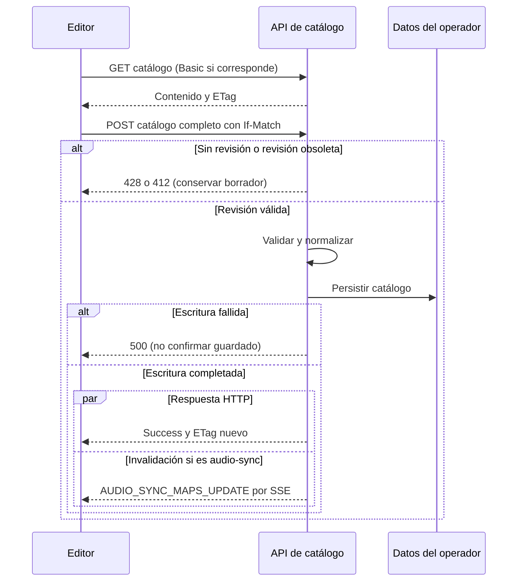

# Sincronización y recuperación

El backend es la autoridad práctica de proyección. Control emite comandos;
[projection-state-reducer](../../server/projection-state-reducer.mjs) los valida
y reduce, [local-server](../../server/local-server.mjs) publica el resultado.
Presenter muestra el snapshot y aporta telemetría; no es necesario para navegar
desde Control hacia Audience. Los contratos están en [realtime](../api/realtime.md)
y [HTTP](../api/http.md).

## Autoridad y transporte

`/ws` lleva estado, comandos, reloj/timeline, admisión, autorización de Controls
y señales Live Audio/privadas. HTTP/SSE conserva snapshots y fallback; el canal
local BroadcastChannel complementa pestañas. Live Audio se entrega a sus
suscriptores WS, fuera del estado de proyección y de BroadcastChannel/SSE.

Las mutaciones HTTP de proyección y telemetría necesitan una credencial vinculada
a WS abierto autorizado,
además de Basic cuando está activado. Al caer el WS, el fallback no conserva
autoridad y recibe 403 hasta reconectar. No atribuir autoridad a un clientId
copiado, una conexión pendiente, presencia LiveKit o formato UUID.

Los snapshots llevan stateEpoch/stateRevision. El gate de
[useSyncState](../../src/hooks/useSyncState.ts) rechaza snapshots antiguos y
evita rollback por GET/SSE/BroadcastChannel. La metadata ordena observaciones;
no persiste el estado ni garantiza ACK, entrega o orden global de comandos.
[ADR 0004](../adr/0004-snapshot-ordering.md) recoge la decisión y sus límites.

Audience recibe una proyección reducida a slide activa y estado funcional de
medios, quiz, scripture y display. Los catálogos públicos y archivos servidos
del operador tienen otras rutas de acceso: el recorte no los protege.

## Timeline, telemetría y efectos locales

[timelineManager](../../server/timelineManager.mjs) mantiene posición base,
tiempo servidor, rate, loop, volumen y cues. [useServerClock](../../src/hooks/useServerClock.ts)
estima offset/RTT; los reproductores aplican timeline y corrigen deriva local
mediante ajustes de rate o seek. La estimación reduce necesidad de broadcasts
frecuentes, sin acreditar sincronía física perfecta.

La telemetría refleja audio/video/display real y actualiza espejos servidor.
No sustituye el permiso de micrófono. Autoduck modifica volumen efectivo local,
preservando volumen canónico. El reproductor iPhone de audio normal tiene su
ciclo propio y no es propietario de la timeline.

Permanecen locales paneles, foco, scroll, previews, borradores y preferencias de
escucha. La fuente Voice se comparte privadamente entre Controls, es transitoria
y no se restaura desde almacenamiento.
No incorporar estos datos a otro snapshot general.

## Sesiones, privacidad y quiz

La política PUBLIC/CONTROLLED pertenece al principal Control. Audience primero
obtiene credencial de acceso, la enlaza a WS y transmite alias cifrado; decisiones,
tickets SSE, quiz y tokens se comprueban en sus fronteras. Credencial de acceso,
identidad Live Audio y submissionId de quiz son entidades distintas.

Los detalles/puntuaciones de quiz permanecen en Audience dentro del TTL local,
separados por presentación. Cada pregunta/resultado utiliza submissionIds de
scope independientes. El servidor transforma contribuciones en contadores y
hashes de deduplicación/capacidad; Control recibe agregados sujetos al umbral de
tres. Esto minimiza vínculo nominal, sin garantizar anonimato frente a red/timing.

Las preguntas contestadas se marcan en Control. Recalcular resultados seleccionados
valida los IDs contra la presentación, ajusta el máximo e incrementa scoreRequestId;
Audience recalcula localmente y envía su rango para esa revisión. El clear HTTP
elimina contadores bajo autoridad de Control activo; el comando de proyección
retira la pregunta de las listas de resultados después de confirmar el clear.
Los aportes de Audience mantienen su guard de admisión separado. Schemas y
comprobaciones de autorización: [HTTP](../api/http.md#quiz).
Un concurso nominal futuro requiere diseño/participación propios.

Los snapshots operacionales de handoff contienen estado técnico y agregados en
RAM; no historial de mensajes, alias, claves privadas ni respuestas individuales.
El contenido de perfiles públicos no incluye alias. Véanse
[Live Audio](../features/live-audio.md) y [privacidad](../privacy/technical-privacy-specification.md).

## Desconexión, sucesión y recuperación

- Cada transporte posee su reconexión. No hay cola persistente común de comandos;
  una operación rechazada debe permanecer visible y requerir acción explícita.
- Al desconectar el principal se promueve el Control autorizado más antiguo.
  Sin autorizados se rota la clave/frontera privada y puede promocionarse el
  pendiente más antiguo. Los clientes renegocian claves y reenvían estado privado
  vigente; no recuperan historial cifrado.
- La identidad de sesión de presentación tiene un marcador privado con duración
  de 24 horas. Reiniciar el proceso puede conservar esa sesión, aunque proyección,
  temporizador, timeline y agregados servidor sean volátiles.
- Después del reinicio, Control vuelve a seleccionar la presentación. Los
  dispositivos Audience que regresan con contribuciones locales pueden reconstruir
  agregados sin duplicar IDs. Los que no vuelven, expiraron o borraron datos no
  aportan recuperación; no existe backup servidor individual.
- RESET_STATE con clearSession, logout, rotación y expiración limpian los estados correspondientes.
  La persistencia del límite de sesión debe completar antes de aceptar el reset.
- La gracia de rejoin de Live Audio conserva estado técnico temporal, no permite
  restaurar automáticamente permisos de hablar tras una nueva admisión. La
  [feature](../features/live-audio.md) detalla captura y reconexión.

Para diagnóstico de outages/IP y preparación de actualizaciones consulte
[operación](../operations/deployment.md). Un test simulado de reconexión no
demuestra recuperación real de SFU, DNS, ICE o navegador.

## Diagramas de los flujos

Cada diagrama responde una pregunta concreta. Los contratos precisos están en
[API](../api/README.md); estas vistas no representan garantías de latencia,
entrega o recuperación completa.

### ¿Dónde se aplica un cambio de proyección?

Presenter renderiza y aporta observaciones de medios. La aplicación de navegación
no depende de tener Presenter abierto. El transporte local entre pestañas
complementa estos caminos; no establece otra autoridad servidor.

### ¿Quién aporta y quién borra resultados de quiz?

Audience no recibe los snapshots agregados administrativos. Control espera
success HTTP antes del clear local y del comando que retira la pregunta de las
listas de proyección. El servidor puede confirmar el borrado aunque un display
pierda conexión después; no hay una transacción global entre transportes.

### ¿Cómo se evita sobrescribir otro guardado de catálogo?

Los catálogos usan Basic cuando auth está activa y revisión ETag; no exigen la
credencial de operador activo de proyección. El estado vivo continúa siendo
transitorio. Respuesta HTTP y recepción SSE no tienen un orden común garantizado.
Los límites del filesystem y del fallback de persistencia están
en [operación](../operations/deployment.md#persistencia-y-actualización).
