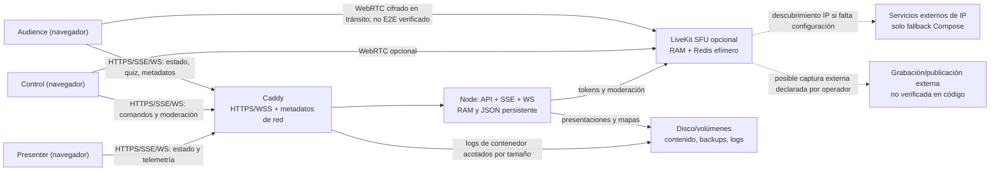

# Fase 1 — Orientación del repositorio

Fecha de revisión: 2026-07-28  
Alcance: arquitectura general, superficies preliminares de datos, infraestructura
y documentación existente.  
Estado: informe técnico preliminar; no constituye el inventario exhaustivo ni
el análisis jurídico.

## 1. Resultado ejecutivo

**[VERIFICADO EN CÓDIGO]** SeferPresenter es una aplicación React/Vite
local-first con entradas separadas para Presenter, Control, Audience, editor de
audio y catálogo público. El backend Node sirve API HTTP, SSE, WebSocket y
estáticos. Evidencia: `vite.config.ts:10-19`, `src/App.tsx:40-45`,
`src/main-control.tsx:36-40`, `src/main-audience.tsx:32-47`,
`server/local-server.mjs:637-970`.

**[VERIFICADO EN INFRAESTRUCTURA]** El despliegue Compose base incluye
aplicación y Caddy; Redis y LiveKit pertenecen al perfil opcional
`live-audio`. Redis tiene persistencia desactivada. La aplicación conserva
presentaciones y mapas de audio en JSON y copias de recuperación en un volumen
separado. Esto describe almacenamiento de contenido, no implica por sí solo
tratamiento de datos personales. Evidencia: `docker-compose.yml:8-50`,
`docker-compose.yml:74-91`, `docker-compose.yml:92-138`.

**[VERIFICADO EN CÓDIGO]** Existe una ruta pública de protección de datos, pero
su texto está embebido en React. El fichero `public/legal/privacy.md` no tiene
consumidores encontrados y contiene afirmaciones que deberán contrastarse en la
Fase 2. Evidencia: `src/App.tsx:834-837`,
`src/main-audience.tsx:329-345`,
`src/components/shared/DataProtectionPage.tsx:1-131`.

**[CONTRADICCIÓN CON EL DISEÑO DECLARADO]** El operador confirma que los alias
deben ser E2E: Audience → Control principal → Controles autorizados, y que solo
los alias cuyo titular autorizó la visibilidad pueden mostrarse a Audience.
Sin embargo, el cliente actual envía `alias` en claro dentro de
`LIVE_AUDIO_ACTIVE_PARTICIPANT_PROFILE`; el servidor lo valida y retransmite en
claro a Controles autorizados. Los identificadores técnicos aleatorios y
efímeros son un dato distinto del alias. Evidencia:
`README.md:202-216`,
`src/features/liveAudio/components/audience/LiveAudioAudienceContainer.tsx:185-200`,
`server/ws-server.mjs:745-754`,
`server/ws-server.mjs:1198-1232`.

**[OBSERVACIÓN OPERATIVA]** El fallback de descubrimiento de IP sirve a
servidores con IP dinámica y no consulta ni transmite la IP de usuarios.
Cuando falta `LIVEKIT_NODE_IP`, el contenedor comunica la IP pública del propio
servidor a `api.ipify.org`, `icanhazip.com` o `ifconfig.me`. La finalidad está
documentada en la auditoría de estabilización, pero el Compose actual lo hace
por HTTP y sin comprobar el interruptor opt-in allí descrito; el README, además,
afirma que no existe esa consulta. Evidencia: `README.md:72-78`,
`docker-compose.yml:98-112`,
`docs/audits/2026-07-24/PRE_AUDIT_STABILIZATION.md:25-28`.

**[PENDIENTE DE CONFIRMACIÓN]** No se ha inspeccionado todavía el despliegue
real ni se ha ejecutado tráfico controlado. Las conclusiones de esta fase
describen el repositorio actual, no garantizan que coincida con la instancia
productiva.

## 2. Mapa del repositorio

| Área | Función observada | Estado y evidencia |
| --- | --- | --- |
| Presenter | Renderiza proyección, medios, texto sagrado y quiz; integra Live Audio opcional por carga diferida. | **[VERIFICADO EN CÓDIGO]** `src/App.tsx:7-9`, `src/App.tsx:839-884` |
| Control | Gestiona contenido, navegación, medios, quiz y autorización de Control. | **[VERIFICADO EN CÓDIGO]** `src/main-control.tsx:5-34`, `src/main-control.tsx:36-75` |
| Audience | Recibe proyección, responde quiz y puede cargar Live Audio opcional. Registra PWA. | **[VERIFICADO EN CÓDIGO]** `src/main-audience.tsx:4-30`, `src/main-audience.tsx:63-65` |
| Editor de audio | Entrada separada para mapas/cues de audio. | **[VERIFICADO EN CÓDIGO]** `vite.config.ts:15-17`, `src/main-audio-editor.tsx` |
| Catálogo público | Consulta catálogos y presentaciones filtradas mediante API pública. | **[VERIFICADO EN CÓDIGO]** `src/components/catalog/CatalogApp.tsx:18`, `server/local-server.mjs:926-954` |
| Backend Node | Estado de proyección, SSE, API, persistencia JSON, quiz, estáticos y conexión a los módulos WS/LiveKit. | **[VERIFICADO EN CÓDIGO]** `server/local-server.mjs:1-69`, `server/local-server.mjs:637-970` |
| WebSocket | Timeline, sincronización operativa, autorización de Controles, moderación y señales privadas. | **[VERIFICADO EN CÓDIGO]** `server/ws-server.mjs:6-35`, `src/types/sync.ts:94-111`, `src/types/liveAudio.ts:58-353` |
| LiveKit | Emite/renueva tokens efímeros y aplica moderación; mantiene participantes y permisos en memoria. | **[VERIFICADO EN CÓDIGO]** `server/livekit-server.mjs:46-75`, `server/livekit-server.mjs:170-205`, `server/livekit-server.mjs:252-269` |
| Redis | Coordinación del perfil opcional LiveKit, sin snapshot ni AOF. | **[VERIFICADO EN INFRAESTRUCTURA]** `docker-compose.yml:74-91` |
| Caddy | Terminación HTTPS y proxy a Node/LiveKit; reenvía IP al backend. | **[VERIFICADO EN INFRAESTRUCTURA]** `Caddyfile:1-24` |
| PWA | Cachea shells y recursos estáticos; excluye API, WS, LiveKit, tokens y medios pesados. | **[VERIFICADO EN CÓDIGO]** `public/audience-sw.js:1-11`, `public/audience-sw.js:65-83`, `public/audience-sw.js:138-204` |
| Contenido persistente | `presentations.json`, `audio_sync.json` y volumen de backups. | **[VERIFICADO EN CÓDIGO]** `server/local-server.mjs:211-245`, `server/local-server.mjs:874-921`; **[VERIFICADO EN INFRAESTRUCTURA]** `docker-compose.yml:40-46` |
| Telemetría | Audio, vídeo, display y reloj/timeline usan mensajes diferenciados del estado completo. | **[VERIFICADO EN CÓDIGO]** `src/types/sync.ts:94-109`, `server/local-server.mjs:783-854` |

## 3. Superficies preliminares de datos

Esta tabla orienta la Fase 2 y no sustituye el inventario por clave o mensaje.

| Superficie | Observación preliminar | Estado |
| --- | --- | --- |
| `localStorage` | Contiene estado de proyección, bloqueo/fondo, tamaños de fuente, sesión Audience y respuestas/puntuaciones de quiz. | **[VERIFICADO EN CÓDIGO]** `src/hooks/useSyncState.ts:226-241`, `src/hooks/useAudienceSession.ts:20-70`, `src/hooks/useQuizAnswers.ts:101-160`, `src/hooks/useSeferControlLogic.ts:35-99` |
| `sessionStorage` | Conserva visibilidad y momento de reaparición del panel de Live Audio dentro de la pestaña. | **[VERIFICADO EN CÓDIGO]** `src/features/liveAudio/components/audience/AudienceLiveAudioPanel.tsx:66-133` |
| IndexedDB | No se encontró uso de API IndexedDB en el código de producto, aunque `public/legal/privacy.md` afirma que se utiliza. | **[CONTRADICCIÓN]** `public/legal/privacy.md:35-45` |
| Cache Storage | Guarda shells, metadatos, textos y activos configurados; excluye endpoints vivos y tokens. | **[VERIFICADO EN CÓDIGO]** `public/audience-sw.js:65-83`, `public/audience-sw.js:138-204` |
| Cookies | No se encontró acceso mediante `document.cookie` en esta orientación. La autenticación HTTP y el comportamiento del navegador requieren análisis separado. | **[INFERENCIA]** pendiente de Fase 2 |
| RAM Node/WS | Estado de proyección, clientes SSE, agregados/respuestas de quiz, participantes, Controles, permisos y tokens LiveKit. | **[VERIFICADO EN CÓDIGO]** `server/local-server.mjs:50-69`, `server/ws-server.mjs:6-15`, `server/livekit-server.mjs:12-19` |
| Disco/volúmenes | Contenido de presentaciones, mapas de audio, medios montados, backups y logs `json-file` de contenedor. El operador declara que las presentaciones actuales no contienen datos personales de participantes; pueden incluir referencias bibliográficas o de autoría para atribución de propiedad intelectual. | **[VERIFICADO EN INFRAESTRUCTURA]** ubicación; **[DECLARADO POR EL OPERADOR]** naturaleza del contenido. `docker-compose.yml:1-5`, `docker-compose.yml:40-46`, `docker-compose.yml:135-138` |
| Voz | Audio WebRTC opcional a un SFU LiveKit self-hosted según la configuración del repositorio. La topología y grabación del despliegue real no están verificadas. | **[VERIFICADO EN CÓDIGO]** `server/livekit-server.mjs`; **[PENDIENTE DE CONFIRMACIÓN]** infraestructura real |
| Alias/mensajes | Las señales `PRIVATE_CONTROL_SIGNAL` están cifradas, pero el perfil activo transporta el alias en claro al servidor. El diseño declarado exige que el alias sea E2E; los identificadores aleatorios efímeros pueden permanecer como identificadores técnicos. | **[CONTRADICCIÓN CON EL DISEÑO DECLARADO]** `src/types/liveAudio.ts:153-160`, `src/types/liveAudio.ts:226-235`, `server/ws-server.mjs:1198-1232` |
| Quiz | El diseño declarado es anónimo y agregado, pero el servidor actual conserva temporalmente respuestas completas y puntuaciones exactas ligadas a `sessionId`; el cliente también guarda el detalle localmente. No se encontró persistencia de servidor en disco. | **[CONTRADICCIÓN CON EL DISEÑO DECLARADO]** `server/local-server.mjs:64-69`, `server/local-server.mjs:347-408`, `server/local-server.mjs:466-482`, `src/hooks/useQuizAnswers.ts:101-160` |

## 4. Mapa preliminar de flujos

## 5. Hallazgos de orientación

### F1-01 — Alias transportado en claro frente al diseño E2E exigido

- Clasificación: **S2 — alto preliminar**
- Estado: **[CONTRADICCIÓN CON EL DISEÑO DECLARADO]**
- Requisito confirmado por el operador: el alias debe viajar cifrado de extremo
  a extremo hasta el Control principal; este puede redistribuirlo cifrado a
  otros Controles autorizados. Solo se muestra a Audience cuando existe permiso
  de visibilidad pública.
- Dato: alias temporal y vinculación a `participantId`.
- Flujo: Audience → servidor WebSocket → Controles autorizados.
- Impacto: el servidor puede inspeccionar el alias durante la sesión; invalida
  actualmente la garantía requerida.
- Distinción: `participantId`, `clientId` y otros valores aleatorios no son el
  alias; son seudónimos técnicos efímeros que deben inventariarse por separado.
- Corrección técnica requerida: eliminar el alias del perfil en claro y usar el
  canal privado cifrado conforme al flujo confirmado.
- Fase de cierre: Fase 2 (trazado completo) y fase de remediación técnica.

### F1-02 — Texto público no conectado y afirmaciones no demostradas

- Clasificación: **S2 — alto preliminar**
- Estado: **[CONTRADICCIÓN]**
- Evidencia: `public/legal/privacy.md` no tiene referencias desde código; la ruta
  pública usa `DataProtectionPage.tsx`.
- Impacto: pueden coexistir dos textos distintos sin prueba de cuál se despliega.
  El Markdown menciona IndexedDB, TTL máximos y garantías de consentimiento que
  esta fase no ha demostrado.
- Corrección: un único origen versionado por tipo de documento, identificador de
  versión desplegada y tests de contenido/barreras.

### F1-03 — Supuestos comunitarios dentro del producto general

- Clasificación: **S2 — alto preliminar**
- Estado: **[VERIFICADO EN INTERFAZ]**
- Evidencia:
  `src/features/liveAudio/components/shared/CollapsiblePrivacyNotice.tsx:25-72`
  presupone reuniones religiosas, grabación y difusión pública; la página
  general también afirma que reuniones ordinarias pueden grabarse.
- Impacto: otras entidades podrían publicar información inexacta y la
  configuración real de un operador queda mezclada con el software general.
- Corrección: textos neutros/versionables en producto y contenido específico
  dentro de la raíz documental local del operador, condicionado por
  configuración verificada.

### F1-04 — Descubrimiento de IP dinámica del servidor incoherente entre código y documentación

- Clasificación: **S4 — observación operativa/documental**
- Estado: **[ACLARADO POR EL OPERADOR]** finalidad; **[CONTRADICCIÓN]**
  implementación/documentación.
- Finalidad confirmada: facilitar LiveKit en servidores con IP pública dinámica.
- Alcance de datos: se comunica la IP pública del servidor, no la IP de los
  usuarios de SeferPresenter.
- Evidencia: `docker-compose.yml:98-112`, `README.md:72-78` y
  `docs/audits/2026-07-24/PRE_AUDIT_STABILIZATION.md:25-28`.
- Corrección: conservar el mecanismo, pero hacerlo opt-in efectivo, usar HTTPS,
  limitar proveedores y alinear README, ejemplo de entorno y Compose.

### F1-05 — Exclusión incompleta de adaptaciones locales

- Clasificación: **S3 — medio**
- Estado inicial: **[VERIFICADO EN INFRAESTRUCTURA]**
- Evidencia inicial: `.gitignore` contenía `*.local` pero no `*.local.*`;
  `config/privacy.local.md` no estaba ignorado.
- Corrección aplicada en esta fase: añadir `*.local.*` y
  `public/legal/*.local/`; mantener los informes y evidencias comunitarios en
  `docs/privacy/audits/<operador>.local/`. `public/legal/` queda reservado para
  ficheros legales, incluidas sus eventuales adaptaciones locales.
- Estado actual: **[BUENA PRÁCTICA VERIFICADA]** mediante `git check-ignore`.

### F1-06 — Logs y retención real todavía no demostrados

- Clasificación: **S3 — medio preliminar**
- Estado: **[PENDIENTE DE CONFIRMACIÓN]**
- Evidencia: Compose acota cada log `json-file` a tres ficheros de 10 MB, pero no
  define un plazo temporal; Caddy reenvía IP a Node.
- Impacto: no puede afirmarse una retención de siete días ni ausencia de IP sin
  observar configuración y logs reales.
- Requisito confirmado por el operador: no conservar registros permanentes de
  IP y aplicar una retención efectiva previsiblemente inferior a siete días.
- Fase de cierre: inventario de Fase 2, ejecución controlada y remediación
  verificable desde Compose.

## 6. Matriz preliminar código-documentación

| Afirmación | Comportamiento observado | Estado | Acción siguiente |
| --- | --- | --- | --- |
| Los alias son E2E y el servidor no los lee. | `LIVE_AUDIO_ACTIVE_PARTICIPANT_PROFILE` contiene alias claro. | **[CONTRADICCIÓN CON EL DISEÑO DECLARADO]** | Cifrar Audience → Control principal y la redistribución a Controles autorizados. |
| Se usa IndexedDB. | No se encontró API IndexedDB en producto. | **[CONTRADICCIÓN]** | Confirmar ausencia en Fase 2 y retirar afirmación si procede. |
| El fallback de IP dinámica pertenece al servidor. | Compose consulta tres servicios HTTP cuando falta `LIVEKIT_NODE_IP`; no transmite IP de usuarios. | **[ACLARADO]** finalidad; **[CONTRADICCIÓN]** en opt-in, HTTPS y README | Conservar la función y alinear implementación y documentación. |
| Redis es efímero. | `--save "" --appendonly no`. | **[VERIFICADO EN INFRAESTRUCTURA]** | Comprobar volúmenes/runtime. |
| API/WS/tokens no entran en Cache Storage. | Exclusión explícita en service worker. | **[VERIFICADO EN CÓDIGO]** | Añadir prueba negativa si falta. |
| Las grabaciones son externas. | No se encontró integración YouTube/Telegram/Egress; solo textos declarativos. | **[INFERENCIA]** | Buscar SDKs, endpoints y configuración en Fase 2; confirmar con operador después. |
| El quiz es anónimo y el servidor solo mantiene agregados. | El servidor mantiene temporalmente respuestas y puntuaciones exactas por `sessionId`; no se encontró escritura de esos mapas a disco. | **[CONTRADICCIÓN CON EL DISEÑO DECLARADO]** | Rediseñar para que el servidor reciba y exponga solo agregados sin relación voto-usuario. |
| Las presentaciones actuales no contienen datos personales de participantes. | El esquema permite texto libre, pero el operador declara que el contenido actual solo puede incluir citas o referencias de autoría. | **[DECLARADO POR EL OPERADOR]** | Verificar el corpus sin convertir la mera autoría bibliográfica en dato de participante. |

## 7. Priorización de la Fase 2

Siguiendo un enfoque de riesgo, la siguiente fase empezará por:

1. alias, señales privadas y mensajes en claro/cifrados;
2. identidad de Audience, credenciales, reanudación y TTL;
3. quiz individual, agregación y purga;
4. micrófono, tokens LiveKit, permisos y publicación de pista;
5. almacenamiento del navegador y dispositivos compartidos;
6. logs, IP, `User-Agent`, cuerpos y errores;
7. grabación/retransmisión y cambios de estado;
8. proveedores, conexiones salientes y transferencias.

No se formulan todavía preguntas organizativas: el encargo exige resolver antes
todo lo que pueda probarse mediante código e infraestructura.

## 8. Verificación de esta fase

- Revisión estática de los archivos de entrada, contratos, servidor, proxy,
  Compose, PWA, avisos y auditorías anteriores.
- Comprobación de exclusión Git para artefactos `*.local.*`.
- `npm.cmd run test -- --maxWorkers=1`: **PASS**, 36 ficheros y 253 tests.
- `npx.cmd tsc --noEmit`: **PASS**.
- No se modificó código de producto.
- No se ejecutó build: no era necesario para una fase documental y puede
  regenerar contenido bajo `public/`.
