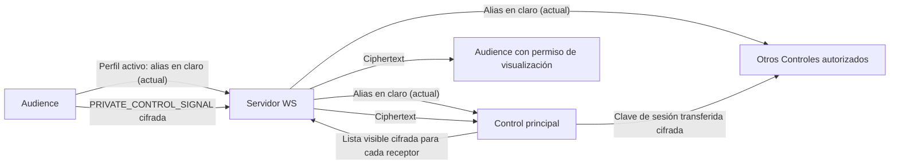
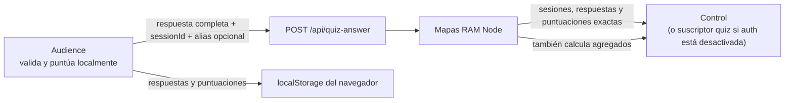

# Fase 2 — Inventario técnico de datos y flujos

Fecha de revisión: 2026-07-29  
Alcance: navegador, API HTTP/SSE, WebSocket, LiveKit, Redis, persistencia,
backups, caché, logs y conexiones salientes.  
Estado: inventario técnico verificable; no constituye todavía análisis jurídico
ni política de privacidad.

## 1. Resultado ejecutivo

La aplicación puede utilizarse de forma pasiva sin cuenta, email ni nombre
real. No se encontró uso de cookies de aplicación ni de IndexedDB. Los
identificadores principales son aleatorios o seudónimos técnicos y la mayor
parte del estado participativo del servidor vive en RAM.

Sin embargo, dos comportamientos actuales contradicen requisitos confirmados:

1. el alias viaja en claro desde Audience al servidor antes de llegar a los
   Controles autorizados;
2. el quiz no es agregado en origen: el servidor recibe y mantiene respuestas,
   puntuaciones exactas y, cuando el usuario hizo visible su alias, también
   `displayName`, todo vinculado a `sessionId`.

Live Audio usa WebRTC y tokens efímeros, pero no se encontró configuración de la
opción E2EE de LiveKit. Por tanto, debe describirse como cifrado en tránsito
hasta el SFU self-hosted, no como audio E2E frente al servidor. Los mensajes
`PRIVATE_CONTROL_SIGNAL` sí implementan cifrado de aplicación mediante ECDH
P-256 y AES-256-GCM.

No se encontró grabación, Egress ni integración con canales de publicación en
el código. Tampoco existe una señal técnica que permita al navegador saber si
un operador externo está grabando. Las afirmaciones sobre grabación son hoy
texto estático.

## 2. Método y etiquetas

Se revisaron los contratos TypeScript, hooks de almacenamiento y sincronización,
servidores HTTP/WS/LiveKit, Compose, Caddy, PWA, dependencias y textos públicos.
También se hizo una búsqueda acotada de patrones en las 231 presentaciones
actuales, sin volcar su contenido en este informe.

Etiquetas:

- **[VERIFICADO EN CÓDIGO]**: comportamiento demostrado por una ruta ejecutable;
- **[VERIFICADO EN INFRAESTRUCTURA]**: configuración demostrada en el repositorio;
- **[DECLARADO POR EL OPERADOR]**: hecho o requisito no inferido del código;
- **[CONTRADICCIÓN]**: documentación o requisito incompatible con el código;
- **[PENDIENTE DE RUNTIME]**: necesita tráfico o inspección del despliegue real.

## 3. Inventario por categoría de dato

| Categoría | Valores observados | Origen y destinatarios | Ubicación y ciclo |
| --- | --- | --- | --- |
| Identificador de navegador | `clientId` con tiempo y `Math.random()` | Cada entrada web → WS y mensajes de sincronización | Memoria de página; aparece en consola del navegador. `src/utils/normalizePresentation.ts:18-21`, `src/hooks/useSyncState.ts:161-166`, `src/hooks/useSyncState.ts:192-201` |
| Sesión de presentación | UUID `presentationSessionId` | Servidor WS → clientes | RAM del servidor y `localStorage` Audience; rota con `RESET_STATE(clearSession)`. `server/ws-server.mjs:10`, `server/ws-server.mjs:1402-1413`, `src/hooks/useAudienceSession.ts:51-71` |
| Sesión Audience | `deviceId`, alias y visibilidad | Generados/introducidos en el navegador | Los valores actuales viven en estado React; claves heredadas de alias/dispositivo se eliminan de `localStorage`. `src/hooks/useAudienceSession.ts:14-49`, `src/hooks/useAudienceSession.ts:78-96` |
| Alias activo | Texto de hasta 80 caracteres, `participantId`, visibilidad y clave pública | Audience → servidor WS → Controles autorizados | Alias transmitido en claro; puede incorporarse a snapshot cifrado en RAM. `src/features/liveAudio/components/audience/LiveAudioAudienceContainer.tsx:185-200`, `server/ws-server.mjs:745-754`, `server/ws-server.mjs:1198-1232` |
| Señal privada | IDs de emisor/destino, `keyId`, nonce y ciphertext | Audience ↔ Controles autorizados, enrutado por servidor | Cifrado ECDH P-256/AES-GCM; claves privadas en memoria de navegador. `src/utils/cryptoUtils.ts:13-129`, `src/hooks/usePrivateControlSignals.ts:144-274`, `server/ws-server.mjs:708-742` |
| Quiz individual | `sessionId`, alias visible opcional, diapositiva, opciones/cita, timestamps y puntuación exacta | Audience → Node → Control; cualquier suscriptor de quiz se considera Control cuando la autenticación está desactivada | Detalle en `localStorage` del cliente y mapas RAM del servidor; el snapshot de Control contiene sesiones y puntuaciones. `src/hooks/useQuizAnswers.ts:38-58`, `src/hooks/useQuizAnswers.ts:101-160`, `server/local-server.mjs:282-291`, `server/local-server.mjs:347-408`, `server/local-server.mjs:466-482` |
| Quiz agregado | número de envíos por diapositiva y rangos de puntuación | Derivado en Node → Control | Mapas RAM; los agregados coexisten con el detalle individual. `server/local-server.mjs:294-320`, `server/local-server.mjs:393-408`, `server/local-server.mjs:437-464` |
| Identidad LiveKit | UUID `participantId`, identidad `rol-UUID`, rol, sala, metadata, JWT/JTI y credencial de renovación | Node → navegador → SFU LiveKit | Navegador en memoria; Node guarda token completo y hash de credencial hasta expiración más gracia. `server/livekit-server.mjs:148-205`, `server/livekit-server.mjs:252-269`, `src/features/liveAudio/hooks/useLiveAudio.ts:614-632` |
| Moderación de audio | permisos, mute, speaker, pista, conexión, controles autorizados | Audience/Control/Presenter ↔ Node/LiveKit | RAM Node/WS; participante desconectado conserva estado durante gracia. `server/ws-server.mjs:757-868`, `server/livekit-server.mjs:15-22` |
| Voz | pista de micrófono y metadata técnica WebRTC | Navegador → SFU → suscriptores | Procesamiento en tiempo real; no se encontró escritura de audio en disco ni Egress. La pista solo se crea al invocar la acción de publicación. `src/features/liveAudio/hooks/useLiveAudio.ts:469-513` |
| Estado de presentación | presentación completa, índice, fondo, medios, escritura, quiz | Control/Presenter/servidor → navegadores | RAM, `localStorage`, SSE/WS/BroadcastChannel; contenido persistente en JSON y backups. `src/hooks/useSyncState.ts:226-241`, `server/local-server.mjs:489-498`, `server/persistence.mjs` |
| Contenido y atribuciones | texto libre, medios, referencias y metadatos | Autor/editor → catálogo/proyección | `presentations.json`, medios y backups. El operador declara que el corpus actual no contiene datos de participantes; la revisión de patrones no encontró emails ni teléfonos. |
| Metadatos de red | IP, `User-Agent`, cabeceras y tiempos inherentes a HTTP/WS/WebRTC | Navegador ↔ Caddy/Node/LiveKit | Visibles técnicamente durante la conexión. No se encontró registro explícito de IP en la app ni access log de Caddy; el runtime de cada contenedor queda pendiente. |

## 4. Almacenamiento del navegador

### 4.1 `localStorage`

| Clave | Contenido | Purga observada | Riesgo |
| --- | --- | --- | --- |
| `sefer-presenter-state` | Presentación normalizada e índice | `RESET_STATE` en la aplicación o limpieza del navegador | Contenido persistente en dispositivo compartido |
| `sefer-presenter-bg-lock` / `sefer-presenter-locked-bg` | Preferencias/estado de fondo | `RESET_STATE` o actualización | Operativo |
| `sefer-presenter-font-hebrew` / `sefer-presenter-font-combined` | Tamaños de fuente | Sin TTL | Preferencia no personal |
| `sefer-audience-session-id` | UUID de la sesión de presentación | logout o sustitución al detectar rotación | Seudónimo técnico |
| `sefer-quiz-answers-by-presentation` | Respuestas completas del usuario por presentación | evento de logout/rotación o limpieza manual | Persistencia local de participación |
| `sefer-quiz-scores-by-presentation` | Puntuaciones por pregunta/presentación | evento de logout/rotación o limpieza manual | Persistencia local de participación |

Las claves heredadas `sefer-audience-device-id`, `sefer-audience-nick`,
`sefer-audience-alias-visible` y `sefer-quiz-session-id` se eliminan; no se
encontró escritura actual de alias en almacenamiento persistente.

### 4.2 Otros almacenes

- `sessionStorage` solo conserva la visibilidad y momento de reaparición del
  panel Live Audio en la pestaña.
- `BroadcastChannel("sefer-presenter")` replica estado de presentación entre
  pestañas del mismo origen.
- `BroadcastChannel("sefer-quiz")` replica respuestas y puntuaciones completas
  entre pestañas del mismo origen.
- Cache Storage guarda shells, metadatos, textos y activos estáticos. Excluye
  `/api`, `/ws`, `/rtc`, `/twirp`, tokens y medios pesados.
- No se encontró uso de IndexedDB ni de `document.cookie`.

Evidencia: `src/features/liveAudio/components/audience/AudienceLiveAudioPanel.tsx:66-133`,
`src/hooks/useSyncState.ts:157-241`, `src/hooks/useQuizAnswers.ts:101-160`,
`public/audience-sw.js:65-83`, `public/audience-sw.js:138-204`.

## 5. Flujo de alias y señales privadas

El canal privado dispone de la primitiva necesaria para cumplir el requisito.
El defecto está en que `LIVE_AUDIO_ACTIVE_PARTICIPANT_PROFILE` crea una ruta
paralela en claro.

El snapshot sensible del WS cifra alias y estados con AES-256-GCM, pero la clave
se deriva de `SEFER_CONTROL_PASSWORD` —o de un valor por defecto conocido si no
existe— y el propio servidor puede descifrarlo. Es cifrado en RAM, no E2E.
Además, la expiración normal tras el periodo de reentrada elimina el participante
pero no borra su entrada del snapshot sensible; el borrado sí aparece en la
salida activa explícita y en el reset de sesión.

Evidencia: `server/ws-server.mjs:53-132`, `server/ws-server.mjs:835-865`,
`server/ws-server.mjs:1180-1233`, `server/ws-server.mjs:1350-1363`.

## 6. Flujo de quiz

El cliente sí calcula la corrección localmente, pero envía más que un agregado.
Cuando `aliasVisible` es verdadero, `main-audience.tsx` pasa el alias como
`quizDisplayName`; este se incorpora a cada `QUIZ_ANSWER`. Node mantiene:

- conjunto de sesiones que respondieron cada diapositiva;
- respuesta completa por `presentationId::sessionId`;
- alias visible opcional por sesión;
- puntuación exacta por sesión;
- rango agregado de puntuación.

No se encontró persistencia de esos mapas en disco. La limpieza existe por
presentación/reset, pero durante la sesión sí hay relación individual accesible
al Control. Además, `/api/quiz-events` es una ruta GET pública y marca todos sus
clientes como Control cuando `SEFER_REQUIRE_AUTH` no es `true`; en ese modo, el
filtro SSE no limita el detalle a un Control autenticado. El endpoint de
snapshot también queda sin barrera cuando se desactiva globalmente la
autenticación.

Evidencia: `src/main-audience.tsx:277`,
`src/hooks/useQuizAnswers.ts:238-255`, `src/hooks/useQuizAnswers.ts:331-346`,
`server/authUtils.mjs:1-39`, `server/local-server.mjs:282-291`,
`server/local-server.mjs:301-320`, `server/local-server.mjs:347-408`,
`server/local-server.mjs:466-482`, `server/local-server.mjs:700-733`.

## 7. Live Audio, micrófono y cifrado

### 7.1 Tokens e identificadores

- `participantId`: UUID v4 del servidor.
- `participantIdentity`: `audience-<UUID>`, `control-<UUID>` o
  `presenter-<UUID>`.
- JWT: incluye identidad, metadata con `participantId`, JTI, sala y permisos.
- TTL por defecto: 30 minutos.
- Renovación: credencial aleatoria de 32 bytes en el navegador; Node guarda solo
  su hash, pero también mantiene el JWT emitido como clave de un mapa hasta TTL
  más gracia.
- Gracia por defecto en código/Compose: 60 segundos; `.env.example` afirma 300,
  por lo que debe alinearse.

### 7.2 Micrófono

La conexión a la sala no crea una pista local. `createLocalAudioTrack` y
`publishTrack` se ejecutan dentro de `publishMicrophone`, invocado por una acción
de interfaz. El navegador sigue siendo quien muestra y resuelve el permiso de
micrófono. La concesión de palabra por Control cambia permisos de publicación,
pero no equivale por sí sola a `getUserMedia`.

Las dos casillas del aviso son estado de interfaz; no existe un registro
persistente de consentimiento. La suficiencia jurídica de esta barrera no se
decide en esta fase.

### 7.3 E2EE de LiveKit

La documentación oficial de LiveKit indica que su E2EE opcional requiere
configurar explícitamente proveedor de claves y worker en el cliente. No se
encontró esa configuración ni referencias `e2ee` en el producto; las conexiones
usan `room.connect(..., { autoSubscribe: false })`.

Conclusión técnica: HTTPS/WSS y WebRTC protegen el transporte, pero el SFU
self-hosted procesa la sesión y no puede afirmarse E2EE de medios frente al
servidor. Esto es independiente del cifrado E2E de
`PRIVATE_CONTROL_SIGNAL`.

## 8. Persistencia, backups, logs y retención

| Componente | Persistencia observada | Límite |
| --- | --- | --- |
| Node de proyección | `presentations.json` y `audio_sync.json` | Persistente |
| Backups | volumen `sefer_backups` | No se encontró plazo temporal en Compose |
| WS/quiz/LiveKit | mapas y sets de proceso | Hasta borrado, reset, TTL o reinicio, según dato |
| Redis | `--save "" --appendonly no` | Efímero por configuración |
| Docker logs | `json-file`, 10 MB × 3 por contenedor | Límite por tamaño, no por tiempo |
| Caddy access log | no hay directiva `log` | No habilitado explícitamente |
| Cache navegador | shell y activos estáticos | Hasta actualización/borrado de caché |

La aplicación no registra explícitamente IP ni `User-Agent` en las rutas
revisadas. Caddy reenvía `X-Real-IP` y `X-Forwarded-For`, por lo que Node puede
ver la IP durante la petición. Queda pendiente comprobar logs por defecto de
LiveKit, Caddy, Docker y plataforma anfitriona en ejecución.

La configuración actual no garantiza una conservación inferior a siete días ni
ausencia permanente de IP: la rotación por tamaño puede retener un fichero
durante un periodo indefinido si hay poco tráfico.

## 9. Proveedores y conexiones salientes

| Destino | Finalidad | Datos |
| --- | --- | --- |
| LiveKit self-hosted | SFU de audio opcional | IP/metadata de red, identidad técnica, permisos y voz |
| Redis self-hosted | coordinación LiveKit | estado operativo efímero; pendiente inspección runtime |
| Servicios de IP pública | descubrir IP dinámica del servidor si falta `LIVEKIT_NODE_IP` | IP pública del servidor, no del usuario |
| Autoridad ACME/DNS de Caddy | HTTPS del despliegue | metadata del servidor/dominio; proveedor real pendiente |

No se encontraron SDKs de analítica, publicidad, error reporting, email, redes
sociales, YouTube, Telegram ni LiveKit Egress en `package.json` o el código de
producto. Las menciones a canales de publicación son declarativas.

## 10. Hallazgos de Fase 2

### F2-01 — Alias en claro contra requisito E2E

- Severidad: **S2 — alto**
- Estado: **[CONTRADICCIÓN CON EL DISEÑO DECLARADO]**
- Causa: `LIVE_AUDIO_ACTIVE_PARTICIPANT_PROFILE` incluye `alias`.
- Requisito de cierre: alias cifrado Audience → Control principal; redistribución
  cifrada solo a Controles autorizados; lista Audience solo con permiso del
  titular y cifrada para receptores autorizados.

### F2-02 — Quiz individual contra requisito agregado

- Severidad: **S2 — alto**
- Estado: **[CONTRADICCIÓN CON EL DISEÑO DECLARADO]**
- Causa: Node recibe y entrega a Control respuesta, alias opcional y puntuación
  exacta por `sessionId`; con autenticación desactivada, cualquier suscriptor de
  `/api/quiz-events` se clasifica como Control.
- Requisito de cierre: el servidor no debe conservar ni exponer relación entre
  voto/respuesta/puntuación y usuario o alias; deben definirse agregados mínimos
  y un control anti-repetición que no reconstruya historial individual. Los
  endpoints de detalle no deben depender de que la autenticación global esté
  activada para aplicar autorización por rol.

### F2-03 — Ruta Audience usa el estado completo

- Severidad: **S3 — medio**
- Estado: **[VERIFICADO EN CÓDIGO]**
- Causa: `main-audience.tsx` usa `useSyncState`, que consulta `/api/state` y
  `/api/state-events`, aunque existen `/api/audience/state` y
  `/api/audience/events` con una vista minimizada.
- Efecto: con autenticación desactivada Audience recibe la presentación y estado
  completos; con autenticación activada las rutas genéricas quedan protegidas,
  creando además incoherencia funcional.
- Requisito de cierre: separar endpoints y contratos por modo, preservando solo
  los datos que Audience necesita para renderizar y validar localmente el quiz.

### F2-04 — Retención local y snapshot sensible incompletamente purgados

- Severidad: **S3 — medio**
- Estado: **[VERIFICADO EN CÓDIGO]**
- Causa: respuestas/puntuaciones permanecen en `localStorage` hasta recibir una
  rotación/logout; la expiración WS no elimina alias del snapshot cifrado.
- Requisito de cierre: TTL y purga idempotente en arranque, rotación, logout,
  desconexión expirada y dispositivo compartido.

### F2-05 — No existe señal verificable de grabación externa

- Severidad: **S2 — alto si el operador graba; no aplicable si nunca graba**
- Estado: **[PENDIENTE DE DECISIÓN ORGANIZATIVA]**
- Causa: la aplicación no integra grabación ni recibe `recordingAvailable` /
  `recordingActive`; el aviso es estático.
- Requisito de cierre: decidir el flujo real y, si existe grabación externa,
  introducir estado confiable, aviso contextual previo y barrera adecuada antes
  de publicar micrófono.

### F2-06 — Logs sin garantía temporal ni prueba de ausencia de IP

- Severidad: **S3 — medio**
- Estado: **[PENDIENTE DE RUNTIME]**
- Causa: límites Docker por tamaño, sin TTL; no se ha inspeccionado el runtime.
- Requisito de cierre: política técnica desde Compose/host, minimización de
  campos, prueba automatizada y verificación periódica.

### F2-07 — Descubrimiento de IP del servidor incoherente

- Severidad: **S4 — observación**
- Estado: **[ACLARADO POR EL OPERADOR]** finalidad; **[CONTRADICCIÓN]**
  implementación/documentación.
- Causa: fallback HTTP implícito frente a diseño documentado como opt-in HTTPS y
  README que niega la consulta.
- Requisito de cierre: conservar la ayuda para IP dinámica, pero hacerla opt-in,
  HTTPS, acotada y coherente.

### F2-08 — Textos públicos no representan un origen desplegable único

- Severidad: **S2 — alto**
- Estado: **[CONTRADICCIÓN]**
- Causa: `/proteccion-datos` renderiza React, mientras
  `public/legal/privacy.md` no tiene consumidor; ambos contienen afirmaciones
  distintas sobre alias, IndexedDB, retención y grabación.
- Requisito de cierre: origen documental único por despliegue, versión visible,
  contenido general neutro y adaptación local separada.

## 11. Controles positivos verificados

- Audience pasiva no necesita cuenta, email, alias ni permiso de micrófono.
- Las claves heredadas que persistían alias/dispositivo se purgan.
- Redis tiene persistencia desactivada.
- API, WS, tokens y medios pesados están excluidos de Cache Storage.
- Los mensajes privados usan ECDH/AES-GCM y protección contra replay de nonce.
- Los Controles pendientes no pueden moderar, consultar alias ni mutar estado.
- Con autenticación activada, los mensajes sensibles del quiz por SSE se
  filtran a clientes con credenciales válidas; el modo sin autenticación queda
  recogido como defecto en F2-02.
- El micrófono no se crea durante la conexión; requiere acción de publicación.
- No se encontró persistencia en disco de alias, quiz, tokens o participantes.

## 12. Pendientes que requieren validación del operador

1. confirmar si alguna sesión se graba o retransmite, con qué herramienta,
   plataformas, responsables, señal de inicio/fin y plazos;
2. confirmar el plazo máximo deseado para logs de infraestructura y backups;
3. identificar host, DNS/ACME, proveedor de conectividad y cualquier proxy o
   servicio externo real;
4. decidir el tratamiento de menores y si la mera casilla es adecuada;
5. confirmar finalidades y destinatarios de voz, alias visible, mensajes y quiz;
6. fijar contacto de derechos, responsable y proceso de incidentes;
7. decidir si las citas de autoría se limitan a información ya publicada y
   necesaria para atribución.

Estos puntos se documentan en el expediente `.local` del operador, sin mezclar
su información con la Fase 3 general de Git, políticas y avisos. Hasta
resolverlos no debe publicarse una política definitiva ni afirmarse
cumplimiento jurídico integral.
