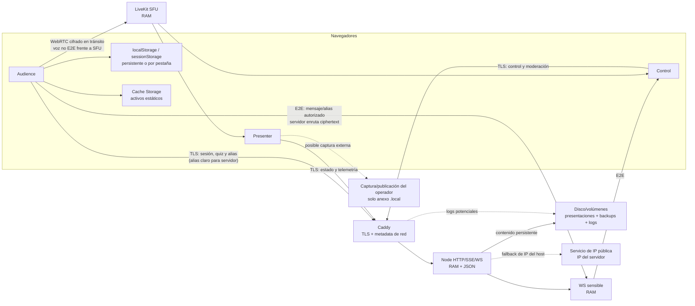

# Fase 4 — Mapa maestro de tratamientos

Fecha de revisión: 2026-07-30  
Alcance: tratamientos que nacen del producto general SeferPresenter. Los
tratamientos propios de un despliegue, sus proveedores y decisiones
organizativas se documentan únicamente en el anexo `.local` de ese operador.  
Estado: mapa técnico completo para el código auditado; las bases jurídicas son
hipótesis pendientes del análisis de la Fase 5.

## 1. Criterio de construcción

Cada fila representa una operación materialmente distinta por finalidad,
destinatario, ubicación o ciclo de vida. No se presume que un identificador
aleatorio sea anónimo: se clasifica como seudónimo mientras permita distinguir
una sesión, dispositivo o participante.

Las columnas «base jurídica posible» y «artículo 9» no son conclusiones
automatizadas. El código puede demostrar qué dato se trata, pero no la base
elegida por cada responsable ni todas las circunstancias organizativas.

Claves de estado:

- **V**: verificado en código o infraestructura;
- **D**: declarado por el operador y conservado solo en su anexo `.local`;
- **C**: contradictorio con el requisito o documentación vigente;
- **P**: pendiente de runtime, decisión humana o remediación.

## 2. Tabla maestra de tratamientos del producto

| ID | Función | Interesado | Dato exacto | Naturaleza | Origen | Finalidad técnica | Finalidad organizativa | Base jurídica posible | Art. 9 | Destinatarios | Ubicación | Transferencia | Cifrado | Retención real | Borrado | Evidencia | Estado | Pregunta necesaria para cada operador | Riesgo |
| --- | --- | --- | --- | --- | --- | --- | --- | --- | --- | --- | --- | --- | --- | --- | --- | --- | --- | --- | --- |
| SP-TR-001 | Acceso pasivo HTTP/SSE/WS | Audience, Control, Presenter | IP, puerto, cabeceras, `User-Agent`, tiempos y ruta | Personal técnico | Dispositivo/red | Establecer conexión, TLS, enrutamiento y defensa operativa | Prestar y proteger el servicio | Art. 6.1.b o 6.1.f, según relación y decisión del responsable | No por sí solo; contexto religioso puede añadir inferencia | Caddy, Node, LiveKit y operador de red | Memoria de procesos y posible log de contenedor/host | Condicionada a infraestructura del operador | HTTPS/WSS/WebRTC en tránsito; reposo no demostrado | Visible durante conexión; logs 10 MB × 3 sin TTL | Cierre de conexión; rotación por tamaño si se registra | `Caddyfile:1-24`; `docker-compose.yml:1-5` | V/P | ¿Qué componentes registran IP o cabeceras en producción y durante cuánto tiempo? | Medio |
| SP-TR-002 | Sincronización de cliente | Todos los modos web | `clientId` temporal, rol, eventos de conexión y telemetría de sincronización | Seudónimo técnico | Navegador | Distinguir conexiones, sincronizar y elegir emisor de telemetría | Operación de la sesión | Art. 6.1.b o 6.1.f, pendiente de Fase 5 | Posible inferencia contextual, no contenido especial por sí solo | Node, clientes autorizados y consola local | RAM de página/servidor; consola del navegador | No en despliegue self-hosted; depende del operador | TLS en tránsito; sin cifrado de aplicación | Vida de página/proceso; consola según navegador | Cierre, reinicio o limpieza de consola | `src/utils/normalizePresentation.ts:18-21`; `src/hooks/useSyncState.ts:161-201` | V | ¿Se recopilan consolas o trazas de navegador de forma remota? | Bajo |
| SP-TR-003 | Sesión de presentación/Audience | Audience | `presentationSessionId` UUID y estado de sesión | Seudónimo técnico | Servidor | Detectar rotación y separar actividad entre sesiones | Continuidad y cierre ordenado de actividades | Art. 6.1.b o 6.1.f, pendiente | Posible inferencia por asociación contextual | Navegador y Node/WS | RAM servidor y `localStorage` Audience | No por producto | TLS en tránsito; sin cifrado de reposo local | Persiste localmente hasta logout o sustitución por rotación | Logout, `RESET_STATE(clearSession)` o limpieza manual | `server/ws-server.mjs:10,1402-1413`; `src/hooks/useAudienceSession.ts:51-71` | V | ¿Cuál es la duración máxima real de una sesión abierta? | Bajo |
| SP-TR-004 | Estado local de presentación y preferencias | Control, Presenter y dispositivo compartido | Presentación activa, índice, fondo, bloqueo y tamaños de fuente | Generalmente operativo; puede contener contenido creado por el operador | Control/servidor | Reanudar proyección y sincronizar pestañas | Mantener configuración de uso | Normalmente Art. 6.1.b/f; revisar si el contenido incluye datos personales | Depende del contenido | Mismo origen y pestañas mediante `BroadcastChannel` | `localStorage`, RAM y BroadcastChannel | No | Protección del origen; sin cifrado de aplicación en reposo | Sin TTL para parte de las preferencias y estado | Reset o limpieza del navegador | `src/hooks/useSyncState.ts:157-241`; `src/hooks/useSeferControlLogic.ts:35-99` | V | ¿Los dispositivos Control/Presenter son compartidos y tienen control de acceso? | Bajo/medio |
| SP-TR-005 | PWA y caché offline | Audience | Shell, metadatos, textos y activos estáticos | No personal por diseño; podría heredar contenido publicado | Servidor/build | Disponibilidad y rendimiento offline | Prestar la aplicación | Excepción de necesidad técnica ePrivacy/LSSI a analizar en Fase 5 | Depende del contenido cacheado | Navegador del usuario | Cache Storage | No | HTTPS en descarga; caché del navegador sin cifrado de aplicación | Hasta actualización del service worker o limpieza de caché | Activación de nueva versión o borrado del navegador | `public/audience-sw.js:65-83,138-216` | V | ¿Se añadirá contenido personalizado a los activos cacheables? | Bajo |
| SP-TR-006 | Alias para solicitar participación/moderación | Audience activa | Alias libre, `participantId`, visibilidad y clave pública | Seudónimo; puede revelar identidad o creencias por texto/contexto | Usuario/navegador | Gestionar cola, mensajes, palabra y moderación | Participación comunitaria definida por cada operador | Art. 6 y, si revela religión, excepción del art. 9 pendientes | **Pendiente; potencial categoría especial** | Servidor WS y Controles autorizados | RAM WS/Control y snapshot sensible en RAM | No por producto self-hosted | TLS; alias actualmente legible por servidor y retransmitido en claro de aplicación | Sesión y gracia; purga incompleta del snapshot en expiración normal | Salida explícita/reset; expiración no limpia toda copia | `LiveAudioAudienceContainer.tsx:185-200`; `server/ws-server.mjs:745-754,1180-1233,1350-1363` | **C** | ¿Debe el servidor ser técnicamente incapaz de leer el alias? Para el diseño confirmado, sí. | Alto |
| SP-TR-007 | Visibilidad voluntaria del alias a otros Audience | Audience activa | Alias autorizado, lista visible y permiso de publicación | Seudónimo; posible dato manifiestamente publicado por el interesado, sin presumirlo | Usuario y Control principal | Compartir presencia/identificación elegida dentro de la sesión | Función social opcional | Consentimiento/confirmación y art. 6 pendientes; no asumir publicación general | Art. 9.2.a/e o 9.2.d requieren análisis y hechos | Audience autorizados y Controles | RAM de navegadores/WS | No por producto | Lista distribuida mediante señales E2E, aunque existe ruta paralela clara de SP-TR-006 | Sesión | Revocación, logout, reset o desconexión; verificar convergencia | `src/hooks/usePrivateControlSignals.ts:144-274`; `server/ws-server.mjs:708-742` | V/C | ¿La revocación elimina inmediatamente el alias de todos los receptores ya autorizados? | Alto |
| SP-TR-008 | Mensaje privado a Control | Audience activa | Alias/ID de origen, texto del mensaje, destino, nonce y ciphertext | Personal/seudónimo; el contenido puede incluir categorías especiales | Usuario | Permitir preguntas o participación sin micrófono | Canal participativo privado | Art. 6 y posible consentimiento/interés/actividad legítima, pendiente | **Depende del contenido; potencial art. 9** | Controles autorizados; servidor solo enruta ciphertext | RAM de navegadores; tránsito WS | No por producto | ECDH P-256 y AES-256-GCM de aplicación, además de TLS; anti-replay | Sesión/memoria de componente | Cierre, reset o desmontaje; confirmar purga de todos los Controles | `src/utils/cryptoUtils.ts:13-129`; `src/hooks/usePrivateControlSignals.ts:144-274`; `server/ws-server.mjs:708-742` | V | ¿Control transcribe, copia o lee públicamente el mensaje fuera de la aplicación? | Alto |
| SP-TR-009 | Autorización de Controles | Personal de Control/administración | `controlSessionId`, `clientId`, código temporal, rol, estado, conexión y autorizador | Seudónimo laboral/organizativo | Navegador, servidor y Control principal | Impedir moderación por Controles no autorizados | Gestión de roles y seguridad | Art. 6.1.b/f o relación organizativa, pendiente | No normalmente | Node y Controles autorizados | RAM WS y snapshot sensible cifrado | No | TLS; snapshot AES-GCM con clave derivada de contraseña del servidor, no E2E | Sesión; código con TTL; estado mientras conexión/autorización exista | Rechazo, desconexión, expiración o reset | `server/ws-server.mjs:171-202,571-693`; `src/hooks/useControlAuthorization.ts:58-145` | V | ¿Qué personas/roles pueden autorizar otro Control y se documenta esa delegación? | Medio |
| SP-TR-010 | Resolución local de quiz | Audience | Respuestas, corrección y puntuación por presentación/pregunta | Seudónimo local; puede revelar conocimiento u opinión según preguntas | Usuario y contenido del quiz | Autoevaluar y conservar progreso tras reconexión | Gamificación/evaluación definida por operador | Art. 6 pendiente; necesidad de almacenamiento local a analizar | Puede revelar religión/opinión según contenido | Propio dispositivo y pestañas del mismo origen | `localStorage`, RAM y BroadcastChannel | No | Protección del origen; sin cifrado de aplicación en reposo | Hasta logout/rotación o limpieza manual; sin TTL de arranque demostrado | Evento de logout/rotación | `src/hooks/useQuizAnswers.ts:101-160,400-513` | V/P | ¿El quiz se limitará a conocimiento o podrá usarse para votaciones/decisiones? | Medio/alto |
| SP-TR-011 | Recepción individual del quiz en servidor | Audience y participante de quiz | `sessionId`, respuesta, cita/opciones, timestamps, puntuación exacta y alias visible opcional | Seudónimo; potencial categoría especial | Navegador Audience | Evitar duplicados, sincronizar y mostrar detalle a Control | El requisito declarado es solo evaluación agregada | Base y necesidad pendientes; el tratamiento actual excede el diseño declarado | **Potencial art. 9 según pregunta/contexto** | Node, Control y suscriptor de quiz; con auth desactivada puede acceder cualquier suscriptor | RAM Node y snapshot Control | No por producto | TLS; contenido legible por servidor/Control | Sesión hasta reset/rotación/reinicio | Reset de presentación/sesión; no persistencia en disco | `server/local-server.mjs:282-320,347-408,466-482,700-733`; `src/hooks/useQuizAnswers.ts:238-255,331-346` | **C** | ¿Existe algún caso autorizado que necesite detalle individual? El requisito actual dice que no. | Alto |
| SP-TR-012 | Agregación de quiz | Participantes como colectivo | Conteos por diapositiva y rangos de puntuación | Agregado; anonimato depende de tamaño y posibilidad de singling out | Derivado por Node | Mostrar evaluación global | Autoevaluación colectiva/gamificación | Art. 6 pendiente; podría quedar fuera de RGPD si es anónimo de forma efectiva | Depende de la pregunta y del tamaño del grupo | Control | RAM Node/Control | No | TLS; legible por servidor/Control | Sesión | Reset, rotación o reinicio | `server/local-server.mjs:294-320,393-464` | V/P | ¿Qué umbral mínimo evita mostrar agregados de grupos demasiado pequeños? | Medio |
| SP-TR-013 | Emisión y renovación de acceso LiveKit | Audience, Control, Presenter | UUID, identidad `rol-UUID`, rol, sala, metadata, JWT/JTI, credencial y hash | Seudónimo técnico y credencial | Node | Autorizar acceso temporal al SFU | Habilitar voz en vivo | Art. 6.1.b/f pendiente | Posible inferencia contextual | Navegador, Node y LiveKit self-hosted | RAM Node/navegador/SFU | No por producto self-hosted | HTTPS; token firmado; hash SHA-256 de credencial; token completo en mapa RAM | JWT 30 min por defecto más gracia; configuración de gracia incoherente | TTL, renovación, desconexión o reinicio | `server/livekit-server.mjs:101-205,252-353`; `src/features/liveAudio/hooks/useLiveAudio.ts:614-632` | V/P | ¿Se exige Live Audio en todos los despliegues o solo por perfil opcional? | Medio |
| SP-TR-014 | Moderación Live Audio | Audience activa y Controles | Permisos, mute, speaker, pista, conexión, solicitudes y rol | Seudónimo y estado participativo | Audience/Control/LiveKit | Conceder palabra, silenciar y mantener la sesión segura | Moderación del acto | Art. 6.1.f/b y posible art. 9 pendientes | Puede revelar participación en actividad religiosa | Controles, Node y LiveKit | RAM WS/Node/SFU | No por producto | TLS/WebRTC; estado legible por servidor | Sesión y periodo de reentrada | Salida, expiración, reset o reinicio | `server/ws-server.mjs:757-868`; `server/livekit-server.mjs:15-22,370-432` | V | ¿Se conservan decisiones disciplinarias fuera de la sesión? | Medio |
| SP-TR-015 | Voz en directo | Persona que activa micrófono y personas audibles accidentalmente | Audio, características de voz y metadata WebRTC | Personal; potencial biométrico solo si se usa para identificar; posible categoría especial por contenido/contexto | Micrófono del dispositivo | Transmitir intervención a suscriptores | Participación oral; posible difusión externa depende del operador | Art. 6 y relación con aviso/consentimiento pendientes | **Potencial art. 9 por contenido religioso o testimonio** | LiveKit self-hosted y suscriptores autorizados | Pista en tiempo real en navegador/SFU | No por producto; captura externa se trata en anexo local | WebRTC cifrado en tránsito; E2EE de medios no configurado | Tiempo real; no se encontró Egress ni escritura en disco | `unpublish`, cierre, desconexión o reinicio | `src/features/liveAudio/hooks/useLiveAudio.ts:469-513`; `server/livekit-server.mjs` | V | ¿Qué sesiones se anuncian como públicas y existe captura externa? | Alto |
| SP-TR-016 | Gestión de presentaciones y mapas de audio | Autores/editores y posibles personas mencionadas | Texto libre, diapositivas, medios, metadatos y cues | Contenido; personal si incluye personas | Editor/operador | Crear, guardar y proyectar contenido | Actividad educativa/cultural/religiosa del operador | Art. 6 y propiedad intelectual pendientes según contenido | Puede contener art. 9 si se introducen testimonios o afiliación | Control, Presenter, Audience/catálogo según publicación | `presentations.json`, `audio_sync.json`, RAM, navegadores y medios | Depende de publicación del operador | TLS en tránsito; disco sin cifrado demostrado | Persistente hasta edición/borrado | Edición o borrado manual | `server/local-server.mjs:211-245,874-921`; `server/persistence.mjs` | V | ¿Se permiten testimonios, fotografías o datos de asistentes en futuras presentaciones? | Medio |
| SP-TR-017 | Atribución pública de obras | Autores citados | Nombre público, obra y año u otra referencia necesaria | Personal manifiestamente público cuando identifica persona física | Fuente publicada/editor | Reconocer autoría y procedencia | Cumplir atribución y propiedad intelectual | Art. 6.1.c/f y normativa de propiedad intelectual, pendiente de Fase 5 | No normalmente; depende de obra/contexto | Audience y público del catálogo/proyección | Presentaciones, catálogo, medios y backups | Según alcance de publicación | Como contenido ordinario | Mientras se use la obra o deba conservarse atribución | Retirada/corrección de obra o cita | `presentations.json`; `server/public-presentations-builder.mjs` | V/D | ¿La cita se limita siempre a información ya publicada y necesaria? | Bajo |
| SP-TR-018 | Backups de contenido | Editores/autores y personas que aparezcan en contenido | Copia previa de presentaciones/mapas | Misma naturaleza que el contenido fuente | Node | Recuperación ante fallo de escritura | Continuidad del servicio | Misma base que el contenido y art. 32, pendiente | Hereda del contenido | Administradores del host | Volumen `sefer_backups` | No por producto | Reposo no demostrado | Persistente; no hay TTL en Compose | Sustitución de backup o borrado administrativo | `server/json-persistence.mjs:59-109`; `docker-compose.yml:38-46,138` | V | ¿Qué política de backup aplica si en el futuro entra contenido personal? | Bajo hoy/variable |
| SP-TR-019 | Logs técnicos de contenedores | Usuarios y administradores | Eventos, errores, roles, rutas y potencial metadata de red/identificadores | Personal o seudónimo si permite correlación | Aplicación, proxy, SFU y runtime | Diagnóstico, seguridad y disponibilidad | Operar y proteger el servicio | Art. 6.1.f y art. 32, pendiente de ponderación/minimización | Puede inferir participación por contexto | Administrador del host y personal con acceso Docker | Driver `json-file` y logs del host | No por producto; depende de soporte externo | Sin cifrado en reposo demostrado | 10 MB × 3 por contenedor; no equivale a plazo | Rotación por tamaño o borrado administrativo | `docker-compose.yml:1-5,55,75,90,133`; logs en `server/*.mjs` | V/P | ¿Se excluye IP y se garantiza un máximo temporal verificable? | Medio |
| SP-TR-020 | Descubrimiento de IP pública del servidor | Operador/host, no Audience | IP pública de salida del servidor | Dato técnico del host; puede asociarse al operador | Servicio externo de eco IP | Configurar LiveKit cuando la IP es dinámica | Facilitar self-hosting | Art. 6.1.f/b pendiente; documentar tercero | No | Servicios externos de IP y contenedor LiveKit | Respuesta en arranque/entorno de contenedor | Sí, conexión saliente a tercero | Implementación actual HTTP; debe migrarse a HTTPS opt-in | Duración de arranque en producto; tercero puede registrar según su política | Fin del proceso; retención del tercero desconocida | `docker-compose.yml:98-112` | V/C | ¿Se activa explícitamente y qué proveedor HTTPS se selecciona? | Bajo/medio |

## 3. Tratamientos deliberadamente fuera de esta tabla general

No se incorporan como hechos generales del producto:

- captura por OBS u otra herramienta;
- retransmisión o grabación en redes sociales;
- comentarios, estadísticas o monetización de plataformas;
- datos del responsable, domicilio y canal de derechos;
- proveedor DNS, ISP, dominio y ubicación física;
- expedientes de derechos o incidentes;
- reglas específicas de menores de un operador.

Cuando existan, son tratamientos reales del responsable y deben figurar en su
mapa `.local`, aunque SeferPresenter no los ejecute directamente.

## 4. Mapa general de flujos

## 5. Riesgos transversales

1. **Singling out:** UUID, `sessionId`, `participantId` y `controlSessionId`
   siguen siendo datos seudónimos cuando distinguen una persona o sesión.
2. **Contexto religioso:** alias, voz, mensajes o quiz aparentemente ordinarios
   pueden revelar creencias o pertenencia por el contexto o contenido.
3. **Doble canal de alias:** el cifrado E2E de señales privadas no compensa la
   ruta paralela en claro.
4. **Quiz:** el agregado coexiste con detalle individual y no hay umbral mínimo
   de grupo.
5. **Dispositivo compartido:** respuestas y estado persisten localmente sin una
   purga por TTL demostrada al arrancar.
6. **Grabación externa:** la aplicación no conoce su estado y el tratamiento no
   puede omitirse del mapa del operador por ocurrir fuera del producto.
7. **Logs:** el límite por tamaño no garantiza siete días ni ausencia de IP.

## 6. Requisitos de cierre antes de usar el mapa como ROPA

- validar el runtime y los logs reales;
- eliminar la ruta en claro del alias o corregir el diseño declarado;
- sustituir el quiz individual por agregados mínimos, con umbral;
- definir TTL y purga idempotente del navegador y snapshots;
- introducir una señal fiable de grabación o un procedimiento verificable del
  operador;
- completar bases, artículos 9, destinatarios, transferencias y encargados en
  Fase 5;
- vincular cada versión del mapa a un commit y manifiesto de despliegue;
- revisar el mapa tras cada cambio de flujo, proveedor, finalidad o retención.

## 7. Verificación

- derivado del inventario exhaustivo de Fase 2 y de la auditoría documental de
  Fase 3;
- una fila por operación materialmente diferenciada;
- las decisiones específicas se mantienen en el anexo `.local`;
- no se asignaron bases jurídicas definitivas por inferencia automática;
- no se modificó código ni se ejecutó build.
