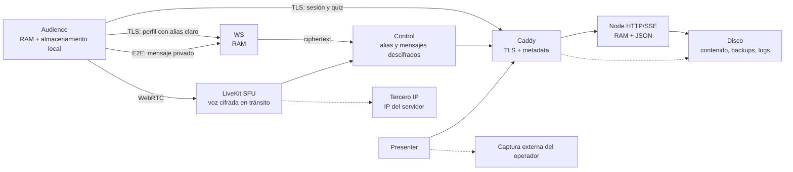

# Fase 6 — Informe provisional consolidado

Fecha: 2026-07-30  
Ámbito: producto general SeferPresenter.  
Los hechos del operador se conservan exclusivamente en su anexo `.local`.

## 1. Resumen ejecutivo

SeferPresenter es una aplicación React/Vite local-first con Presenter, Control,
Audience, editor de audio y catálogo. Node presta API/SSE/WS, persiste
presentaciones/mapas y coordina LiveKit opcional. Caddy termina TLS; Redis se
configura efímero en el perfil Live Audio.

El nivel de privacidad es **parcial**:

- arquitectura favorable: audiencia pasiva, IDs aleatorios, micrófono local,
  mensajes E2E, LiveKit self-hosted y ausencia de Egress;
- garantías incompletas: alias claro paralelo, quiz individual, TTL parciales,
  logs sin plazo temporal, estado de grabación inexistente y textos legales
  desincronizados.

Los riesgos principales son la identificación contextual en actividades
religiosas, exposición de alias, detalle de quiz, publicación externa decidida
por operadores y afirmaciones absolutas no respaldadas.

## 2. Hallazgos

### PA-01 — Alias legible por servidor

- **Clasificación:** S2 — alto.
- **Estado:** contradicción.
- **Evidencia:** `LiveAudioAudienceContainer.tsx:185-200`;
  `server/ws-server.mjs:745-754,1180-1233`.
- **Dato:** alias, `participantId`, visibilidad y clave pública.
- **Flujo:** Audience → WS/Node → Controles.
- **Impacto:** invalida la afirmación E2E absoluta y permite inspección/correlación.
- **Norma potencial:** arts. 5, 25 y 32 RGPD; art. 9 según contexto.
- **Corrección técnica:** retirar alias del perfil claro y usar solo canal E2E.
- **Corrección documental:** describir el estado real hasta verificar el cambio.

### PA-02 — Quiz individual contrario a finalidad agregada

- **Clasificación:** S2 — alto.
- **Estado:** contradicción.
- **Evidencia:** `src/hooks/useQuizAnswers.ts:238-256`;
  `server/local-server.mjs:347-482`.
- **Dato:** `sessionId`, `displayName`, respuesta, contenido y puntuación.
- **Flujo:** Audience → Node RAM → Control.
- **Impacto:** permite singling out y excede la necesidad de resultado global.
- **Norma potencial:** arts. 5, 6, 9 y 25 RGPD.
- **Corrección técnica:** agregación sin detalle y umbral mínimo.
- **Corrección documental:** no llamarlo anónimo mientras siga el flujo.

### PA-03 — Sin estado fiable de grabación

- **Clasificación:** S2 — alto.
- **Estado:** no implementado.
- **Evidencia:** no existe contrato/mensaje de grabación; aviso estático en
  `DataProtectionPage.tsx:102-105`.
- **Dato:** voz y confirmación de la intervención pública.
- **Flujo:** depende de captura externa del operador.
- **Impacto:** aviso/consentimiento pueden no corresponder al estado.
- **Norma potencial:** arts. 5, 7, 9, 13 y 25 RGPD.
- **Corrección técnica:** estado `off/live/recording` e invalidación de permiso.
- **Corrección documental:** avisos por estado, no afirmación genérica.

### PA-04 — Dos fuentes legales y despliegue no identificable

- **Clasificación:** S2 — alto.
- **Estado:** contradicción.
- **Evidencia:** ruta React usa `DataProtectionPage.tsx`; `public/legal/privacy.md`
  no tiene consumidor; `dist/legal/privacy.md` puede quedar obsoleto.
- **Dato:** información jurídica recibida.
- **Impacto:** no puede probarse qué texto correspondía al software.
- **Norma potencial:** arts. 5.2, 7 y 12-14 RGPD.
- **Corrección:** origen único, versión, manifiesto y test de build/despliegue.

### PA-05 — Logs por tamaño, no por tiempo

- **Clasificación:** S3 — medio.
- **Estado:** pendiente.
- **Evidencia:** `docker-compose.yml:1-5,135-138`.
- **Dato:** stdout/stderr y posible metadata.
- **Impacto:** no garantiza plazo ni ausencia de IP/datos sensibles.
- **Norma potencial:** arts. 5.1.e, 25 y 32 RGPD.
- **Corrección:** allowlist, TTL real y prueba de runtime.

### PA-06 — Persistencia local sin TTL general

- **Clasificación:** S3 — medio.
- **Estado:** parcial.
- **Evidencia:** `useAudienceSession.ts`, `useQuizAnswers.ts`,
  `useSyncState.ts`.
- **Dato:** alias, sesión, respuestas y preferencias.
- **Impacto:** exposición en dispositivo compartido y declaraciones de borrado
  demasiado amplias.
- **Corrección:** TTL, purga idempotente, logout/rotación y tests.

### PA-07 — Descubrimiento IP del servidor

- **Clasificación:** S4 — bajo.
- **Estado:** utilidad legítima con implementación débil.
- **Evidencia:** `docker-compose.yml:98-112`.
- **Dato:** IP pública del host, no de Audience.
- **Impacto:** conexión HTTP a tercero y documentación incoherente.
- **Corrección:** IP explícita o proveedor HTTPS opt-in; describirlo como
  mecanismo para servidores con IP dinámica.

### PA-08 — Historial Git sin custodia legal

- **Clasificación:** S3 — medio.
- **Estado:** pendiente.
- **Evidencia:** rama/remoto desincronizados, sin reglas/release legal verificable
  y rastros de reescritura local.
- **Dato:** código y prueba documental.
- **Impacto:** débil trazabilidad e integridad.
- **Corrección:** repositorio/rama protegidos, revisión y releases inmutables.

### PA-09 — Mensajes privados E2E

- **Clasificación:** buena práctica verificada.
- **Estado:** verificado en código.
- **Evidencia:** `cryptoUtils.ts:13-129`,
  `usePrivateControlSignals.ts:144-274`.
- **Límite:** no extender la garantía a otros mensajes o alias.

### PA-10 — Micrófono local y LiveKit sin Egress

- **Clasificación:** buena práctica verificada.
- **Estado:** verificado en código.
- **Evidencia:** `useLiveAudio.ts:469-526`; `server/livekit-server.mjs`.
- **Límite:** WebRTC no es E2E frente al SFU y un operador puede capturar fuera.

## 3. Inventario preliminar

La tabla maestra completa de 20 tratamientos está en
`PHASE-04-MASTER-PROCESSING-MAP.md`. Resumen:

| IDs | Área | Riesgo dominante |
| --- | --- | --- |
| SP-TR-001 a 005 | Red, sesión, estado local y PWA | Metadata y persistencia local |
| SP-TR-006 a 009 | Alias, visibilidad, mensajes y Control | Identificación, art. 9 y acceso |
| SP-TR-010 a 012 | Quiz local, individual y agregado | Singling out y grupos pequeños |
| SP-TR-013 a 015 | Tokens, moderación y voz | Credenciales, voz y publicación externa |
| SP-TR-016 a 018 | Presentaciones, atribución y backups | Contenido libre y persistencia |
| SP-TR-019 a 020 | Logs e IP del servidor | Retención y terceros técnicos |

## 4. Mapa de flujos

## 5. Matriz código-documentación

| Afirmación existente | Código real | Estado | Corrección |
| --- | --- | --- | --- |
| Alias E2E/no legible por servidor | Perfil contiene alias claro | Contradictorio | Corregir protocolo y texto |
| Quiz anónimo/agregado | Node guarda detalle por sesión | Contradictorio | Solo agregados + umbral |
| IndexedDB | No se encontró API | Contradictorio | Eliminar afirmación |
| Datos solo RAM | Navegador, JSON, backups y logs persisten | Demasiado absoluto | Desglosar por dato |
| Se elimina al cerrar | No hay TTL/purga completa demostrada | Parcial | TTL y pruebas |
| Grabación activa | Producto desconoce OBS | No demostrado | Estado fiable |
| No hay terceros | Caddy/ACME/IP/proveedores dependen del despliegue | Incorrecto por defecto | Inventario por operador |
| No transferencias | Depende de proveedores/publicación | No generalizable | Matriz contractual |

## 6. Resultado

El producto es recuperable mediante correcciones focalizadas. No se detecta una
necesidad de reescritura global, pero no debe certificarse como plenamente
anónimo, E2E o agregado hasta cerrar PA-01 a PA-06.
