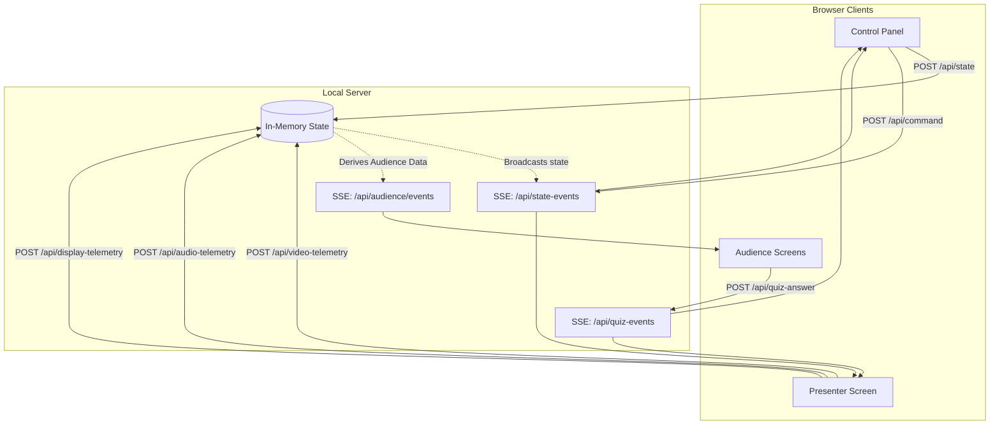
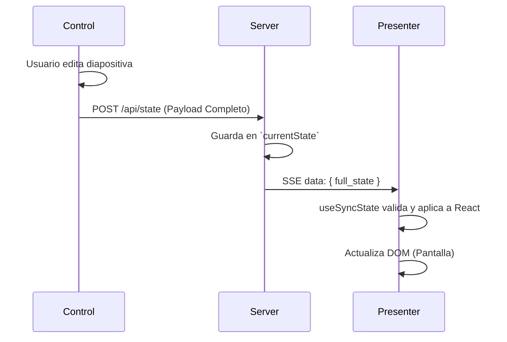
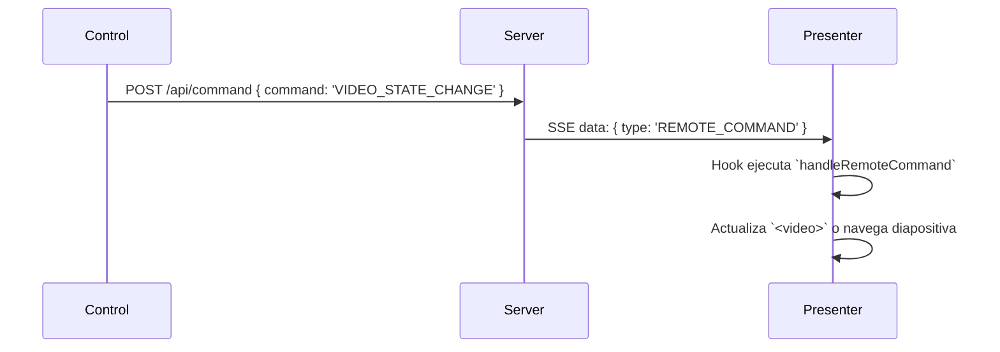
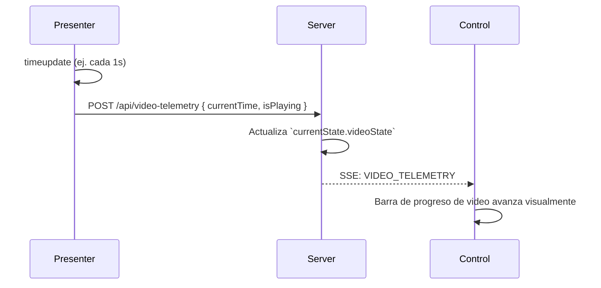
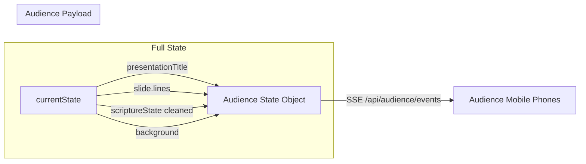

# Arquitectura de Sincronización (SeferPresenter)

Este documento detalla exhaustivamente todos los mecanismos de sincronización actuales entre el Panel de Control, la Pantalla de Presentador, el Servidor y la Audiencia. Su propósito es permitir una revisión profunda antes de comenzar la refactorización para el modo **online**.

---

## 1. Topología General de Comunicación

El sistema actual utiliza un backend ligero en Node.js que actúa principalmente como un "espejo" o puente (router) de mensajes. La principal fuente de la verdad funcional es el **Control** (que empuja el estado) y el **Presentador** (que lo proyecta y devuelve telemetría).

---

## 2. Tipos de Mensajes y Flujos de Datos

La sincronización en `useSyncState.ts` maneja múltiples tipos de payloads (`src/types/sync.ts`). A continuación se representan gráficamente los flujos de los más críticos:

### A. Flujo de Sincronización de Estado Completo (`SYNC_STATE`)
Se dispara cuando cambias de diapositiva, editas texto o activas un modo diferente (ej. de Diapositivas a Escrituras).

> [!WARNING]
> **Punto de Optimización:** Actualmente todo el objeto gigante (`Presentation`, `SlideIndex`, `ScriptureState`, etc.) se envía en bloque a través de `POST /api/state` ante cualquier cambio mínimo de edición en el panel de control.

### B. Flujo de Comandos Remotos (`REMOTE_COMMAND`)
Utilizado para acciones inmediatas que no requieren enviar toda la presentación, como "Avanzar Diapositiva", "Play/Pause Video", "Lanzar Cuestionario".

### C. Flujo de Telemetría (`*_TELEMETRY`)
Usado principalmente por el **Presentador** para informar al **Control** sobre el tiempo actual de un video/audio, o si está reproduciéndose.

> [!TIP]
> **Nota de Diseño:** La telemetría se emite cada 1 segundo (a través de `timeupdate` o un `setInterval`). El servidor actualiza su caché en memoria y hace broadcast al Control para que la barra de tiempo (`MediaControls`) se mueva sola.

---

## 3. Estado Derivado de la Audiencia

La Audiencia no recibe toda la información de la presentación privada. El Servidor **deriva y recorta** la información en `deriveAudienceState()` en `local-server.mjs`.

> [!IMPORTANT]
> **Seguridad actual:** Dado que la derivación ocurre en el servidor Node.js local, los clientes de audiencia no tienen acceso a diapositivas futuras ni datos ocultos. Sin embargo, para migrar a "Online", este filtro derivado deberá replicarse en la nube de forma segura (ej. en un backend serverless, WebSockets o Firestore rules).

---

## 4. Oportunidades de Optimización para la Refactorización Online

Al mover la arquitectura a un servidor online (WebSockets, Firebase, Supabase, o similar), la estructura actual presenta algunos cuellos de botella:

1. **Payloads Masivos (`POST /api/state`):** 
   En LAN, enviar 500kb JSON en cada pulsación de tecla o cambio de color no es problema. Online, esto consumirá mucho ancho de banda y causará latencia.
   *Posible solución:* Implementar un modelo de deltas (parches JSON) o guardar la presentación en base de datos y solo sincronizar el `slideIndex` y un hash de versión.

2. **Telemetría Frecuente (`POST /api/video-telemetry`):**
   1 petición HTTP POST por segundo por presentación saturará un backend serverless/online. 
   *Posible solución:* Usar WebSockets persistentes para telemetría, o interpolar el tiempo en el cliente de Control (basándose en un solo mensaje de "Play") y solo enviar telemetría cuando el usuario pausa o retrasa manualmente.

3. **Duplicidad de `BroadcastChannel` vs Servidor:**
   Actualmente `useSyncState` intenta transmitir tanto por `BroadcastChannel` (tabs locales) como por red (fetch/SSE). 
   *Posible solución:* En modo online, unificar todo detrás del proveedor online, o hacer que el BroadcastChannel solo funcione en "Modo Local Estricto".

## Siguientes Pasos
Revisa estos diagramas. Si la estructura actual (Estado Completo vs Comandos vs Telemetría vs Audiencia) se alinea con tu visión para la estructura online, podemos proceder a planificar cómo conectar esto a la base de datos o WebSockets remotos elegidos.
